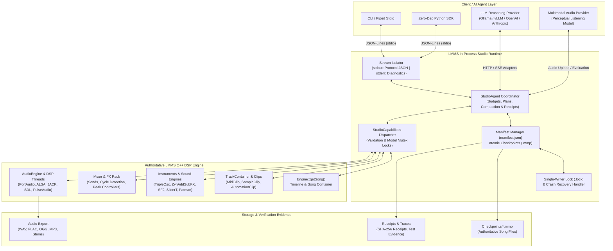

<div align="center">

# 🎵 HEAV3NS-MUSE

### **The Agent-Native Digital Audio Workstation, Built on LMMS**

*A persistent, conversational C++ music production runtime where autonomous AI agents inspect, compose, synthesize, mix, render, and evaluate music directly on native DAW DSP models.*

---

[](LICENSE.txt)
[](CMakeLists.txt)
[](CMakeLists.txt)
[](INSTALL.txt)
[](doc/agent-native-architecture.md)
[](doc/native-studio-protocol.md)
[](https://github.com/LMMS/lmms)

```text
  ___ ___  _________   ____   __________ _______    _____  ____ ___  ______ ____
 /   |   \/   _____/  /  _ \  \______   \\      \  /     \/    |   \/  ___// __ \
/    ~    \_____  \  /  /_\  \  |     ___//   |   \/  --  \|    ~   /\___ \\  ___/
\___|_  //______  / /    |    \ |____|   /___|__  /  /\/\  \___/|_  /____  >\___  >
      \/        \/  \____|__  /                 \/__/__  \      \/     \/     \/
```

**[⚡ Quickstart](#-quickstart-in-60-seconds)** •
**[📦 Platform Setup](#-platform-prerequisites--installation)** •
**[🏗️ Architecture](#-architecture--the-studio-loop)** •
**[💡 REPL & Python SDK](#-studio-repl--zero-dependency-python-sdk)** •
**[📖 Creative Cookbook](#-creative-cookbook--workflow-recipes)** •
**[🎛️ Synth Showcase](#-bundled-synthesizers--sound-engines)** •
**[📋 Capabilities](#-studio-capabilities-reference)** •
**[📡 Wire Protocol](#-wire-protocol--ipc-reference)** •
**[🤖 Agent Reasoning](#-conversational-agent--reasoning-loops)** •
**[🔊 Hardware](#-audio--midi-hardware-backends)** •
**[🛡️ Durability](#-storage-architecture--crash-resilience)** •
**[🧪 Testing](#-testing--verification-suites)** •
**[❓ Troubleshooting](#-troubleshooting--faq)** •
**[🗺️ Roadmap](ROADMAP.md)** •
**[🛠️ Maintainers](MAINTAINERS.md)**

---

</div>

## 🌟 Overview & Paradigm Shift

**HEAV3NS-MUSE** is an architectural evolution of [LMMS](https://github.com/LMMS/lmms), transforming the venerable open-source digital audio workstation into a **persistent, conversational studio runtime**. 

Instead of generating disposable MIDI snippets or black-box audio stems, HEAV3NS-MUSE embeds an in-process agent runtime (`StudioRuntime`) directly into the LMMS C++ engine. Autonomous reasoning agents participate as native studio collaborators: discovering instruments, editing arrangement timelines, shaping synthesizer envelopes, routing mixer sends, rendering stems, and perceptually evaluating the results—with complete `.mmp` project compatibility and full graphical presentation parity.

```text
┌────────────────────────────────────────────────────────────────────────────────────────┐
│                        THE AUTONOMOUS MUSIC PRODUCTION LOOP                            │
│                                                                                        │
│   Interpret ➔ Plan ➔ Compose ➔ Synthesize ➔ Mix ➔ Render ➔ Listen ➔ Evaluate ➔ Revise  │
└────────────────────────────────────────────────────────────────────────────────────────┘
```

### Why Agent-Native DAW?

| Vector | Traditional DAW + AI Plugins | Ephemeral Code Generators | **HEAV3NS-MUSE (Agent-Native DAW)** |
| :--- | :--- | :--- | :--- |
| **Execution Model** | Manual human DAW operation | One-shot Python/JS scripts | **In-process conversational agent loop** |
| **State Authority** | GUI memory state | Ephemeral `.mid` / `.wav` files | **Authoritative native LMMS C++ DSP models** |
| **Non-Destructive Workflow** | Manual DAW undo | Statically baked exports | **Atomic `.mmp` checkpoints with multi-turn undo** |
| **Sound Synthesis** | VST/Plugin black boxes | Fixed soundfonts or GM banks | **60+ native synths, samplers, SoundFonts & VSTs** |
| **Evaluation Loop** | Human ears only | Blind generation without feedback | **Render ➔ Technical DSP Analysis ➔ Perceptual Audio Listening** |
| **Headless Operation** | Requires display server | Script CLI only | **Dual Mode: Headless (`QCoreApplication`) & Qt GUI** |
| **Session Memory** | None (forgotten on exit) | None (per-run variables) | **Durable memory, preferences & decision recall** |

[⬆ Back to Top](#-heav3ns-muse)

---

## ⚡ Quickstart in 60 Seconds

### 1. Clone with Pinned Submodules

```sh
git clone --recurse-submodules https://github.com/CardSorting/heav3ns-muse.git
cd heav3ns-muse
```

> [!TIP]
> If you cloned without submodules, initialize them immediately: `git submodule update --init --recursive`. This restores bundled synthesis engines (ZynAddSubFX, FluidSynth, Carla, AdPlug).

### 2. Build Out-of-Tree

Requires CMake 3.13+, a C++20 compiler (`gcc` 11+, `clang` 13+, or MSVC 2022), and Qt 5.15+ (or Qt 6 via `-DWANT_QT6=ON`):

```sh
cmake -S . -B build -DBUILD_TESTING=ON
cmake --build build --parallel
```

### 3. Launch an Agent Studio Session

Run a persistent, headless studio session that communicates over line-delimited JSON stdio:

```sh
./build/lmms studio ./my-studio-session --config ~/.lmms-config.xml
```

### 4. Interactive "Hello World" Pipeline

Pipe line-delimited JSON commands directly to `./build/lmms studio` to initialize a project, load a synth, write a 4-bar melody, and render an audio file:

```sh
cat << 'EOF' | ./build/lmms studio ./my-studio-session
{"id":"1","op":"project.new","args":{"empty":true}}
{"id":"2","op":"song.set","args":{"tempo":128,"masterVolume":100}}
{"id":"3","op":"track.add","args":{"type":"instrument","name":"Lead Synth"}}
{"id":"4","op":"instrument.load","args":{"track":0,"instrument":"tripleoscillator"}}
{"id":"5","op":"clip.add","args":{"track":0,"position":0}}
{"id":"6","op":"note.batch.add","args":{"track":0,"clip":0,"items":[{"position":0,"length":48,"key":60},{"position":48,"length":48,"key":64},{"position":96,"length":48,"key":67},{"position":144,"length":96,"key":72}]}}
{"id":"7","op":"project.save","args":{"path":"./my-studio-session/composition.mmp"}}
{"id":"8","op":"audio.render","args":{"path":"./my-studio-session/output.wav"}}
{"id":"9","op":"audio.analyze","args":{"path":"./my-studio-session/output.wav"}}
EOF
```

To inspect and continue working on this song in the full LMMS Graphical Interface at any point:

```sh
./build/lmms ./my-studio-session/composition.mmp
```

[⬆ Back to Top](#-heav3ns-muse)

---

## 📦 Platform Prerequisites & Installation

<details open>
<summary><b>🍎 macOS (Homebrew)</b></summary>

Install all required build tools, audio libraries, and Qt packages using the repository's bundled [Brewfile](Brewfile):

```sh
brew bundle
cmake -S . -B build -DCMAKE_PREFIX_PATH="$(brew --prefix qt@5)" -DBUILD_TESTING=ON
cmake --build build --parallel
```
</details>

<details>
<summary><b>🐧 Ubuntu / Debian (20.04 / 22.04 / 24.04)</b></summary>

Install the complete dependency suite matching the CI configuration:

```sh
sudo apt-get update && sudo apt-get install -y \
  build-essential cmake git ccache \
  qtbase5-dev qttools5-dev-tools libqt5svg5-dev \
  libsndfile1-dev libasound2-dev libjack-jackd2-dev \
  libpulse-dev libsdl2-dev portaudio19-dev \
  libfftw3-dev libfluidsynth-dev libgig-dev \
  libmp3lame-dev libogg-dev libvorbis-dev libsamplerate0-dev \
  liblilv-dev lv2-dev libstk-dev

cmake -S . -B build -DBUILD_TESTING=ON
cmake --build build --parallel
```
</details>

<details>
<summary><b>🪟 Windows (MSYS2 / vcpkg)</b></summary>

Using the repository's native [vcpkg.json](vcpkg.json) manifest:

```cmd
vcpkg install --triplet x64-windows
cmake -S . -B build -DCMAKE_TOOLCHAIN_FILE=%VCPKG_ROOT%/scripts/buildsystems/vcpkg.cmake -DBUILD_TESTING=ON
cmake --build build --config Release --parallel
```
</details>

[⬆ Back to Top](#-heav3ns-muse)

---

## 🏗️ Architecture & The Studio Loop

### Subsystem Flowchart



### Architectural Guarantees

1. **Native C++ Model Authority**: All operations mutate live LMMS C++ engine objects (`Engine::getSong()`, `PatternStore`, `Mixer`). There are no duplicate JSON ASTs or out-of-sync shadow state models.
2. **Two-Stage Audio Understanding**: Technical audio metrics (peak dBFS, RMS power, clipping detection, silence ratios, spectral centroid) are computed deterministically in C++ (`audio.analyze`). Perceptual, subjective critique is handled by an external audio multimodal reasoning model (`audio.listen`).
3. **Optimistic Concurrency & Revision Locking**: Clients can pass `expectedRevision`. If another concurrent action modified the song, the mutation is rejected before applying edits.
4. **Complete Stream Isolation**: Protocol frames are strictly routed to `stdout`. Native engine logs, C++ diagnostic outputs, and ALSA/JACK warnings are redirected to `stderr`.

[⬆ Back to Top](#-heav3ns-muse)

---

## 💡 Studio REPL & Zero-Dependency Python SDK

HEAV3NS-MUSE can be driven using any language via standard I/O. Below is a lightweight, zero-dependency Python client you can immediately drop into your AI agents or orchestration frameworks (LangChain, AutoGen, CrewAI, FastMCP):

```python
import json
import subprocess
import uuid
from pathlib import Path

class StudioClient:
    """Zero-dependency IPC wrapper for HEAV3NS-MUSE native studio."""

    def __init__(self, lmms_bin: str, session_dir: str, config: str = None):
        cmd = [lmms_bin, "studio", session_dir]
        if config:
            cmd.extend(["--config", config])
        self.process = subprocess.Popen(
            cmd,
            stdin=subprocess.PIPE,
            stdout=subprocess.PIPE,
            stderr=subprocess.PIPE,
            text=True,
            bufsize=1
        )
        # Read the initial 'ready' event
        ready_frame = json.loads(self.process.stdout.readline())
        assert ready_frame.get("event") == "ready", f"Unexpected startup: {ready_frame}"
        self.revision = ready_frame.get("revision", 0)

    def call(self, op: str, args: dict = None, expected_rev: int = None) -> dict:
        """Execute a typed C++ capability operation."""
        req_id = str(uuid.uuid4())[:8]
        payload = {"id": req_id, "op": op, "args": args or {}}
        if expected_rev is not None:
            payload["expectedRevision"] = expected_rev
        self.process.stdin.write(json.dumps(payload) + "\n")
        self.process.stdin.flush()

        while True:
            line = self.process.stdout.readline()
            if not line:
                raise RuntimeError("Studio process terminated unexpectedly")
            frame = json.loads(line)
            # Skip unsolicited async events and match request ID
            if frame.get("id") == req_id:
                if frame.get("ok"):
                    self.revision = frame.get("revision", self.revision)
                    return frame.get("result", {})
                raise RuntimeError(frame.get("error", "Unknown studio error"))

    def chat(self, prompt: str) -> dict:
        """Submit natural-language intent to the in-process agent."""
        return self.call("session.chat", {"text": prompt})

    def close(self):
        try:
            self.call("session.shutdown")
        except Exception:
            pass
        self.process.terminate()
        self.process.wait()

    def __enter__(self):
        return self

    def __exit__(self, exc_type, exc_val, exc_tb):
        self.close()

# --- Example Usage ---
if __name__ == "__main__":
    with StudioClient("./build/lmms", "./session-test") as studio:
        print("Initialized session at revision:", studio.revision)
        studio.call("project.new", {"empty": True})
        studio.call("song.set", {"tempo": 140})
        studio.call("track.add", {"type": "instrument", "name": "Bassline"})
        studio.call("instrument.load", {"track": 0, "instrument": "lb302"}) # TB-303 clone
        studio.call("clip.add", {"track": 0, "position": 0})
        # Add 16th-note acid bassline
        notes = [{"position": i * 24, "length": 24, "key": 36 + (i % 7)} for i in range(16)]
        studio.call("note.batch.add", {"track": 0, "clip": 0, "items": notes})
        studio.call("audio.render", {"path": "./session-test/acid.wav"})
        analysis = studio.call("audio.analyze", {"path": "./session-test/acid.wav"})
        print("Rendered peak amplitude (dBFS):", analysis.get("peakDbfs"))
```

[⬆ Back to Top](#-heav3ns-muse)

---

## 📖 Creative Cookbook & Workflow Recipes

### 🥁 Recipe 1: Generative BeatMatrix Rhythm (Kick + Snare + Hi-Hats)

Use the 16-step beat-and-bassline sequencer for fast drum programming:

```json
{"id":"r1-1","op":"track.add","args":{"type":"pattern","name":"Drum Kit"}}
{"id":"r1-2","op":"instrument.load","args":{"track":0,"instrument":"audiofileprocessor"}}
{"id":"r1-3","op":"sample.load","args":{"track":0,"clip":0,"path":"data/samples/drums/kick01.ogg"}}
{"id":"r1-4","op":"step.set","args":{"track":0,"clip":0,"step":0,"enabled":true}}
{"id":"r1-5","op":"step.set","args":{"track":0,"clip":0,"step":4,"enabled":true}}
{"id":"r1-6","op":"step.set","args":{"track":0,"clip":0,"step":8,"enabled":true}}
{"id":"r1-7","op":"step.set","args":{"track":0,"clip":0,"step":12,"enabled":true}}
{"id":"r1-8","op":"step.clone","args":{"track":0,"clip":0}}
```

### 🎹 Recipe 2: Lush Ambient Pad with LFO Filter Sweep (Hermite Automation)

Automate a synthesizer filter cutoff knob with smooth Hermite cubic curves:

```json
{"id":"r2-1","op":"track.add","args":{"type":"instrument","name":"Ambient Pad"}}
{"id":"r2-2","op":"instrument.load","args":{"track":0,"instrument":"zynaddsubfx"}}
{"id":"r2-3","op":"track.add","args":{"type":"automation","name":"Filter Sweep"}}
{"id":"r2-4","op":"clip.add","args":{"track":1,"position":0}}
{"id":"r2-5","op":"automation.point","args":{"track":1,"clip":0,"position":0,"value":0.1,"progression":2,"tension":0.5}}
{"id":"r2-6","op":"automation.point","args":{"track":1,"clip":0,"position":192,"value":0.85,"progression":2,"tension":0.5}}
{"id":"r2-7","op":"automation.point","args":{"track":1,"clip":0,"position":384,"value":0.2,"progression":2,"tension":0.5}}
```

### 📐 Recipe 3: Microtonal Scala Tuning Setup

Load historical tunings, Arabic quarter-tones, or just intonation into native instrument models:

```json
{"id":"r3-1","op":"tuning.scale.set","args":{"slot":0,"name":"19-EDO Equal Temperament","intervals":["1/19","2/19","3/19","4/19","5/19","6/19","7/19","8/19","9/19","10/19","11/19","12/19","13/19","14/19","15/19","16/19","17/19","18/19","2/1"]}}
{"id":"r3-2","op":"tuning.keymap.set","args":{"slot":0,"name":"Standard Middle-C Origin","mapping":"0\n1\n2\n3\n4\n5\n6\n7\n8\n9\n10\n11\n12\n13\n14\n15\n16\n17\n18"}}
{"id":"r3-3","op":"instrument.tuning.inspect","args":{"track":0,"key":60}}
```

### 🎧 Recipe 4: Stem-by-Stem Multi-Track Rendering & DSP Analysis

Render isolated instrument stems and check them for digital clipping or silence before delivery:

```json
{"id":"r4-1","op":"audio.render","args":{"path":"./stems/drums.wav","track":0,"sampleRate":48000,"bitDepth":24}}
{"id":"r4-2","op":"audio.render","args":{"path":"./stems/bass.wav","track":1,"sampleRate":48000,"bitDepth":24}}
{"id":"r4-3","op":"audio.analyze","args":{"path":"./stems/drums.wav"}}
{"id":"r4-4","op":"audio.analyze","args":{"path":"./stems/bass.wav"}}
```

[⬆ Back to Top](#-heav3ns-muse)

---

## 🎛️ Bundled Synthesizers & Sound Engines

HEAV3NS-MUSE includes the full suite of native LMMS instruments, all addressable via `instrument.load`:

| Plugin Identifier | Engine Name | Synthesis Method | Primary Musical Use Case |
| :--- | :--- | :--- | :--- |
| `tripleoscillator` | Triple Oscillator | Subtractive, AM, FM, Phase Sync | Leads, basslines, 808s, analog brass |
| `zynaddsubfx` | ZynAddSubFX | Additive, Subtractive, PadSynth | Lush ambient pads, orchestral strings, bells |
| `audiofileprocessor`| AFP Sampler | PCM sample playback, loop bounds | Acoustic drums, vocal chops, one-shots |
| `slicert` | SlicerT | Transient beat slicer with pitch | Breakbeats, hip-hop chopping, drum loops |
| `lb302` | LB302 | Monophonic Roland TB-303 emulator | Acid basslines, squelchy resonance leads |
| `bitinvader` | BitInvader | User-drawn wavetable chiptune | 8-bit game audio, Commodore SID tones |
| `patman` | Patman | Gravis UltraSound (.pat) player | Retro tracker instruments, legacy patches |
| `sf2player` | SF2 Player | FluidSynth SoundFont 2 loader | General MIDI backing, acoustic pianos |
| `opulenz` | OpulenZ | Yamaha YM3812 (OPL2/OPL3) FM synth | Sega Genesis / AdLib FM percussion & brass |
| `monstro` | Monstro | 3-oscillator FM monster synth | Cyberpunk bass, aggressive modern leads |
| `organic` | Organic | Additive drawbar organ with rotary | Church organs, Hammond B3 drawbar sounds |
| `sid` | SID 6581/8580 | MOS Technology C64 chip emulator | Authentic chiptune arpeggios, pulse sweeps |

[⬆ Back to Top](#-heav3ns-muse)

---

## 📋 Studio Capabilities Reference

HEAV3NS-MUSE exposes **over 60 high-level, typed C++ DAW operations** covering the complete LMMS feature set:

### 🎼 Project, Song & Timeline
| Operation | Key Parameters | Mutates | Description |
| :--- | :--- | :---: | :--- |
| `project.new` | `empty`, `summary` | Yes | Initialize a new song project. |
| `project.load` | `path`, `summary` | Yes | Load an existing `.mmp` or `.mmpz` project. |
| `project.save` | `path`, `withResources` | No | Serialize current state to native LMMS XML/compressed format. |
| `project.import` | `path`, `container`, `pattern` | Yes | Import external MIDI or project files into arrangement tracks. |
| `project.exportMidi` | `path` | No | Export editable tracks and notes as Standard MIDI File (`.mid`). |
| `project.inspect` | `section`, `track`, `clip`, `offset` | No | Deep inspection of tracks, clips, notes, routes, and warnings. |
| `song.set` | `tempo`, `masterVolume`, `masterPitch` | Yes | Set master tempo (BPM), master gain, and pitch transposition. |
| `timeline.set` | `begin`, `end`, `enabled` | Yes | Configure arrangement loop points and cycle mode. |

### 🎛️ Tracks & Clips
| Operation | Key Parameters | Mutates | Description |
| :--- | :--- | :---: | :--- |
| `track.add` | `type`, `name`, `container` | Yes | Create instrument, sample, pattern, or automation tracks. |
| `track.edit` | `track`, `name`, `muted`, `solo`, `to` | Yes | Rename, mute, solo, or reorder tracks in the arrangement. |
| `track.clone` | `track`, `container` | Yes | Duplicate a track, its instrument settings, and its effect chain. |
| `track.remove` | `track`, `container` | Yes | Safely remove an idle track and disarm active routing. |
| `clip.add` | `track`, `position`, `name` | Yes | Insert an empty arrangement clip at specified tick position. |
| `clip.edit` | `track`, `clip`, `position`, `length`, `offset` | Yes | Non-destructive clip timing, resizing, and trimming. |
| `clip.split` | `track`, `clip`, `position` | Yes | Split a clip into two independent clips at a tick offset. |
| `clip.clone` | `track`, `clip`, `position`, `targetTrack` | Yes | Copy clip data to a target track or pattern cell. |
| `clip.selection.copy`| `items: [{track, clip, position}]` | Yes | Batch copy up to 4,096 clips preserving linked groups. |

### 🎹 Piano Roll, Notes & Microtuning
| Operation | Key Parameters | Mutates | Description |
| :--- | :--- | :---: | :--- |
| `note.add` | `track`, `clip`, `position`, `length`, `key`, `volume` | Yes | Insert an explicitly timed MIDI note with velocity and panning. |
| `note.batch.add` | `track`, `clip`, `items: [...]` | Yes | High-speed batch insertion of up to 4,096 notes in one undo step. |
| `note.edit` | `track`, `clip`, `note`, `key`, `volume` | Yes | In-place modification of note pitch, length, or velocity. |
| `note.remove` | `track`, `clip`, `note` | Yes | Remove a single note from a MIDI clip. |
| `note.clear` | `track`, `clip` | Yes | Clear all notes in a clip while preserving clip geometry. |
| `note.selection.shift` | `notes: [...]`, `semitones`, `ticks` | Yes | Transpose pitch and/or shift timing of selected notes. |
| `note.selection.quantize` | `notes: [...]`, `grid`, `mode` | Yes | Quantize note starts and/or lengths to musical tick grids. |
| `note.selection.reverse` | `notes: [...]` | Yes | Invert note timing horizontally within selection bounds. |
| `note.selection.length` | `notes: [...]`, `mode`, `length` | Yes | Batch set, trim, or legato-fill note durations. |
| `note.selection.glue` | `notes: [...]` | Yes | Merge contiguous or overlapping notes of the same pitch. |
| `note.selection.split` | `notes: [...]`, `position` | Yes | Split crossing notes at a relative tick position. |
| `note.selection.knife` | `notes: [...]`, `fromPosition`, `fromKey`, `toPosition`, `toKey` | Yes | Cut notes along a continuous 2D coordinate line. |
| `note.detuning.point` | `note`, `position`, `value`, `progression`, `tension` | Yes | Add microtonal pitch bends / detuning points to individual notes. |

### 🥁 Beat & Bassline Sequencer
| Operation | Key Parameters | Mutates | Description |
| :--- | :--- | :---: | :--- |
| `step.set` | `track`, `clip`, `step`, `enabled` | Yes | Toggle a rhythm cell in the 16-step beat matrix. |
| `step.resize` | `track`, `clip`, `count` | Yes | Resize pattern row from 1 to 4,096 steps across full musical bars. |
| `step.clone` | `track`, `clip` | Yes | Double pattern length, duplicating existing step triggers. |

### 🎻 Sound Design, Synthesis & Slicing
| Operation | Key Parameters | Mutates | Description |
| :--- | :--- | :---: | :--- |
| `instrument.load` | `track`, `instrument`, `attributes` | Yes | Load TripleOscillator, ZynAddSubFX, BitInvader, Monstro, Patman, etc. |
| `instrument.inspect` | `track`, `offset`, `limit` | No | Enumerate synthesizer knobs, filter types, and modulation envelopes. |
| `sample.load` | `track`, `clip`, `path`, `preserveSettings` | Yes | Load audio files (WAV, FLAC, OGG, MP3) into sample tracks. |
| `sample.edit` | `track`, `clip`, `startFrame`, `endFrame`, `gain`, `reversed` | Yes | Non-destructive sample windowing, reverse playback, and gain. |
| `instrument.slices.analyze` | `track`, `estimateTempo` | Yes | Run native transient detection to auto-slice sample loops. |
| `instrument.slices.edit` | `track`, `points: [0.0, ..., 1.0]` | Yes | Set custom slice boundary points across a sample. |
| `clip.fromSlices` | `track`, `clip`, `targetTrack`, `position` | Yes | Generate piano roll trigger notes corresponding to sliced beats. |
| `preset.load` / `save` | `track`, `path` | Yes/No | Load or save native `.xpf` instrument presets. |
| `graph.set` / `load` | `track`, `graph`, `values`, `path` | Yes | Draw or decode custom single-cycle waveforms for oscillators. |
| `expression.set` | `track`, `expression`, `source` | Yes | Compile mathematical expressions for procedural waveform synthesis. |

### 🔌 External Plugins & Modular Patchbays
| Operation | Key Parameters | Mutates | Description |
| :--- | :--- | :---: | :--- |
| `plugin.list` | `subplugins` | No | Enumerate installed LADSPA, LV2, and VST plugins. |
| `host.plugin.add` | `track`, `format`, `path`, `uniqueId` | Yes | Host VST/LV2 plugins via native plugin hosts or Carla. |
| `host.parameter.set` | `track`, `hostedPlugin`, `hostedParameter`, `value` | Yes | Automate parameters inside third-party VST/LV2 plugins. |
| `host.catalog.start` | `track`, `format`, `binary`, `path` | No | Scan filesystem directories for new third-party plugins. |
| `host.patchbay.connect` | `track`, `sourceGroup`, `sourcePort`, `destGroup`, `destPort` | Yes | Modularly wire audio, MIDI, and CV routing in Carla Patchbay. |

### 📐 Microtonality & Scala Tunings
| Operation | Key Parameters | Mutates | Description |
| :--- | :--- | :---: | :--- |
| `tuning.scale.load` | `slot`, `path` | Yes | Load Scala (`.scl`) pitch tuning files. |
| `tuning.scale.set` | `slot`, `name`, `intervals` | Yes | Program arbitrary microtonal intervals and just intonations. |
| `tuning.keymap.load` | `slot`, `path` | Yes | Load Scala Keyboard Mapping (`.kbm`) definition files. |
| `instrument.tuning.inspect` | `track`, `key` | No | Inspect calculated frequencies (Hz) for every MIDI key. |

### 🎚️ Mixer, Routing & Effects
| Operation | Key Parameters | Mutates | Description |
| :--- | :--- | :---: | :--- |
| `mixer.add` | `name` | Yes | Add a discrete mixing channel strip to the mixer rack. |
| `mixer.edit` | `channel`, `name`, `volume`, `muted`, `solo`, `to` | Yes | Adjust fader volume, channel mute, solo, and rack position. |
| `mixer.route` | `from`, `to`, `amount` | Yes | Create send routes with cycle detection and send amount. |
| `mixer.unroute` | `from`, `to` | Yes | Disconnect send routing between two channels. |
| `effect.add` | `channel`, `plugin`, `attributes` | Yes | Add native delay, reverb, equalizer, compressor, or distortion. |
| `effect.move` | `channel`, `effect`, `direction`, `to` | Yes | Reorder insert effects within a channel's processing chain. |
| `effect.clear` | `channel` | Yes | Clear all effect inserts from a mixer channel. |

### 📈 Automation & Controllers
| Operation | Key Parameters | Mutates | Description |
| :--- | :--- | :---: | :--- |
| `automation.connect` | `track`, `clip`, `parameter` | Yes | Bind a track or mixer parameter to an automation curve. |
| `automation.point` | `track`, `clip`, `position`, `value`, `progression`, `tension` | Yes | Insert automation nodes (discrete, linear, or Hermite cubic). |
| `controller.add` | `type`, `name` | Yes | Add LFO, Peak Controller, or MIDI controller to the rack. |
| `controller.connect` | `controller`, `parameter` | Yes | Link modulation controllers directly to any synthesiser parameter. |
| `controller.midi.learn` | `parameter`, `port`, `timeoutMs` | Yes | Listen for external hardware MIDI CC knobs and bind them automatically. |

### 🎧 Audio Rendering & DSP Analysis
| Operation | Key Parameters | Mutates | Description |
| :--- | :--- | :---: | :--- |
| `audio.render` | `path`, `sampleRate`, `bitDepth`, `stereoMode`, `exportLoop` | No | Render entire song mix or isolated stems to WAV, FLAC, OGG, or MP3. |
| `audio.analyze` | `path`, `maximumSeconds` | No | Measure peak amplitude, RMS power, clipping count, and silence. |
| `audio.listen` | `path`, `prompt` | No | Submit rendered audio to multimodal audio provider for critique. |

[⬆ Back to Top](#-heav3ns-muse)

---

## 📡 Wire Protocol & IPC Reference

HEAV3NS-MUSE communicates over `stdin` and `stdout` using newline-delimited JSON (JSON-Lines). Each line is an independent JSON object up to 1 MiB in size.

### Request Envelope

```json
{
  "id": "req-001",
  "op": "track.add",
  "args": {
    "type": "instrument",
    "name": "Sub Bass"
  },
  "expectedRevision": 4
}
```

- **`id`** *(string, required)*: Unique request identifier (1 to 128 characters). Used for correlation and replay deduplication.
- **`op`** *(string, required)*: The capability or session operation name.
- **`args`** *(object, required)*: Key-value parameters corresponding to the operation schema.
- **`expectedRevision`** *(integer, optional)*: Optimistic concurrency lock. Rejects the operation if the project revision has advanced.

### Response Envelope

```json
{
  "id": "req-001",
  "ok": true,
  "revision": 5,
  "result": {
    "track": 1,
    "name": "Sub Bass"
  }
}
```

If an operation fails, `ok` is `false`, and an explanatory `error` message is returned:

```json
{
  "id": "req-001",
  "ok": false,
  "revision": 4,
  "error": "Track index 8 is out of bounds (current project has 2 tracks)"
}
```

### Real-Time Runtime Events

The runtime pushes unsolicited notification frames during session lifecycle changes:

```json
{"event":"ready","session":"/path/to/session","revision":0,"applicationType":"QCoreApplication","transport":{"playing":false,"position":0}}
{"event":"agent","job":{"id":"job-8f2a","status":"running","operations":12,"elapsedMs":1450}}
{"event":"shutdown","ok":true,"reason":"process interrupt"}
```

### Idempotency & Replay Protection

Every mutating request is fingerprinted via SHA-256 and committed with its receipt into `<session-dir>/receipts/<uuid>.json`. Re-submitting an identical `id` returns the cached response with `"replayed": true`, preventing duplicate note insertions or double-track additions during network retries.

[⬆ Back to Top](#-heav3ns-muse)

---

## 🤖 Conversational Agent & Reasoning Loops

HEAV3NS-MUSE includes native HTTP adapters for OpenAI-compatible and Anthropic inference APIs, allowing local models (via Ollama, vLLM, LM Studio) or frontier cloud models to act directly as music producers.

### 1. Configure the Reasoning Provider

Send `session.provider.set` to configure your language model:

```json
{
  "id": "set-llm",
  "op": "session.provider.set",
  "args": {
    "role": "reasoning",
    "configuration": {
      "protocol": "chat_completions",
      "endpoint": "http://127.0.0.1:11434/v1/chat/completions",
      "model": "qwen2.5-coder:32b",
      "keyEnv": "OLLAMA_API_KEY",
      "timeoutMs": 60000
    }
  }
}
```

> [!NOTE]
> For security, API keys are never stored in plain text within project manifests. The `keyEnv` field specifies the name of the environment variable containing the bearer token.

### 2. Configure the Perceptual Audio Provider

Configure an audio multimodal model to critique rendered compositions:

```json
{
  "id": "set-audio",
  "op": "session.provider.set",
  "args": {
    "role": "audio",
    "configuration": {
      "protocol": "chat_completions",
      "endpoint": "https://api.openai.com/v1/chat/completions",
      "model": "gpt-4o-audio-preview",
      "keyEnv": "OPENAI_API_KEY",
      "timeoutMs": 120000
    }
  }
}
```

### 3. Submitting Natural Language Production Prompts

Submit conversational intent either via `session.chat` or by sending raw natural-language text directly into `stdin`:

```json
{
  "id": "prompt-1",
  "op": "session.chat",
  "args": {
    "text": "Add a crisp, syncopated hi-hat pattern on sixteenth notes with velocity variation, then add a resonant low-pass filter to the lead synth.",
    "maxRounds": 8,
    "maxOperations": 50,
    "maximumWallTimeMs": 120000,
    "maximumCpuTimeMs": 30000,
    "maximumResidentMiB": 2048
  }
}
```

### 4. Agent Job Controls

- **`agent.inspect`**: Inspect active plan, tool invocation history, step progress, and resource utilization.
- **`agent.plan.set`**: Allows the agent to publish structured production plans (`goal`, `steps`, `decisions`).
- **`agent.context.compact`**: Compresses long conversation trajectories into structured summaries, avoiding token limits.
- **`agent.cancel`**: Immediately halts active inference or execution without corrupting song state.
- **`agent.resume`**: Resumes paused jobs with updated resource budgets.
- **`agent.finish`**: Closes a job with verifiable tool-call evidence (`evidence: ["call-id-1", "call-id-2"]`).

[⬆ Back to Top](#-heav3ns-muse)

---

## 🔊 Audio & MIDI Hardware Backends

HEAV3NS-MUSE supports full real-time hardware operation as well as headless virtual studio runs.

### Supported Drivers

| System Driver | Audio Device Kind | MIDI Driver Kind | Linux | macOS | Windows |
| :--- | :--- | :--- | :---: | :---: | :---: |
| **PortAudio** | DirectSound, WASAPI, CoreAudio, ALSA | N/A | ✅ | ✅ | ✅ |
| **ALSA** | Advanced Linux Sound Architecture | `alsaseq` / `alsaraw` | ✅ | ❌ | ❌ |
| **JACK** | Low-latency audio server | JACK MIDI client | ✅ | ✅ | ❌ |
| **PulseAudio** | Desktop audio daemon | N/A | ✅ | ❌ | ❌ |
| **SDL** | Simple DirectMedia Layer | N/A | ✅ | ✅ | ✅ |
| **Apple MIDI** | N/A | CoreMIDI client | ❌ | ✅ | ❌ |
| **WinMM** | N/A | Windows Multimedia MIDI | ❌ | ❌ | ✅ |
| **sndio** | OpenBSD audio framework | sndio MIDI | ✅ | ❌ | ❌ |
| **Dummy** | In-memory clock (no audio hardware needed) | Null MIDI | ✅ | ✅ | ✅ |

### Live Driver Inspection & Switching

Discover and switch drivers at runtime without restarting the process:

```json
{"id":"list-backends","op":"audio.backend.list","args":{}}
{"id":"switch-audio","op":"audio.backend.select","args":{"name":"jack"}}
{"id":"switch-midi","op":"midi.backend.select","args":{"name":"alsaseq"}}
```

[⬆ Back to Top](#-heav3ns-muse)

---

## 🛡️ Storage Architecture & Crash Resilience

Every studio session directory is a self-contained, fully auditable package.

### Directory Structure

```text
my-studio-session/
├── session.lock              # QLockFile single-writer session lock
├── session.json              # Atomic manifest, request ledger, preferences & agent state
├── checkpoints/              # Immutable LMMS song snapshots
│   ├── a8b3f120-....mmp      # Snapshot for revision 1
│   └── 3c91d4e0-....mmp      # Snapshot for revision 2
├── receipts/                 # Larger request receipts, created as needed
│   ├── e4f1092a-....json     # Archived execution outcome & response
│   └── 90bcf312-....json
├── conversations/            # Archived conversation pages, created as needed
├── tool-results/             # Larger native tool records, created as needed
├── contexts/                 # Compacted agent inference contexts, created as needed
└── jobs/                     # Archived agent jobs, created as needed
```

Musical preference memory lives in `session.json`. Read it with `session.inspect`
and replace it with `session.memory.set`; the operation accepts one `memory`
object. Preserve existing keys when constructing a replacement, or explicitly
clear memory with `{"memory":{}}`. Preferences are scoped to this session
directory and remain separate from native project undo/redo and `.mmp` export.
See the [memory contract](doc/native-studio-protocol.md#musical-preference-memory)
for examples, replay behavior and recovery guidance.

### Persistence and Recovery Behavior

- **Single writer**: `session.lock` rejects another cooperating studio process opening the same session directory.
- **Acknowledged state**: Native checkpoints precede publication of `session.json` through `QSaveFile`. Recovery validates referenced checkpoints and request records before restoring the project.
- **Bounded cleanup**: The committed retirement queue supports bounded cleanup of owned obsolete artifacts. It does not establish universal orphan cleanup, power-loss durability or protection from arbitrary external file modification.

Dated platform observations and practical limits are retained in the
[engineering record](doc/agent-native-architecture.md).

[⬆ Back to Top](#-heav3ns-muse)

---

## 🧪 Testing & Verification Suites

HEAV3NS-MUSE includes a rigorous test suite combining unit tests and end-to-end process-level integration harnesses.

### 1. Unified Local Verification Interface (Recommended)

Run repository-wide verification matching CI/CD gates locally:

```sh
# Fast pre-commit verification (Hygiene, Knowledge, and Security gates)
./scripts/verify.sh quick

# Focused Gate 1 Knowledge Integrity verification
./scripts/verify.sh knowledge

# Focused Gate 4 Security Baseline (tokens, boundary fuzzing, path traversal)
./scripts/verify.sh security

# Full verification suite including regression and change impact analysis
./scripts/verify.sh full
```

### 2. Native CTest Suite

```sh
ctest --test-dir build --output-on-failure
```

### 3. Comprehensive Process-Level Integration Harness

Exercises headless studio startup, JSON protocol boundaries, audio synthesis correctness, signal interruption (`SIGINT`/`SIGTERM`), memory budgets, and mock inference loops:

```sh
python tests/studio_process_test.py --lmms ./build/lmms --output ./build/studio-evidence
```

### 4. VST & External Host Stress Harness

Tests external plugin discovery, parameter modulation, and Carla patchbay connections without a display server:

```sh
python tests/studio_vst_process_test.py --lmms ./build/lmms --output ./build/vst-evidence
```

### 5. Musical Preference Memory Restart Harness

Verify explicit palettes, scale preferences and compositional rules across clean
and abrupt native process restarts, including session isolation and request replay:

```sh
python3 tests/studio_memory_process_test.py --lmms ./build/lmms --output ./build/studio-memory-evidence
```

The harness retains local protocol traces and prints public-safe fixture
observations. It does not evaluate inferred taste or a model's musical judgment.

[⬆ Back to Top](#-heav3ns-muse)

---

## ❓ Troubleshooting & FAQ

<details open>
<summary><b>1. Why is rendered audio completely silent?</b></summary>

By default, launching `lmms studio <dir>` boots with **dummy** audio/MIDI drivers to allow fast, headless offline rendering. If you want live sound during playback or real-time recording, you must supply `--studio-live` and an active backend, e.g.:
```sh
./build/lmms studio ./my-session --studio-live --studio-audio portaudio
```
</details>

<details>
<summary><b>2. How do I fix "Project revision changed; inspect current state before editing"?</b></summary>

This error occurs when you provide an `expectedRevision` argument that does not match the current session revision. Run `project.inspect` or inspect the last response's `revision` field to re-synchronize your client before submitting new edits.
</details>

<details>
<summary><b>3. Why does the agent stop with "Resident memory budget exceeded"?</b></summary>

HEAV3NS-MUSE enforces safety ceilings against runaway memory leaks during sustained AI composition sessions. You can increase the limit by passing a larger `maximumResidentMiB` parameter in your `session.chat` or `agent.resume` call (e.g. `maximumResidentMiB: 4096`).
</details>

<details>
<summary><b>4. How do I load my own WAV/FLAC drum samples?</b></summary>

Use `sample.load` specifying the absolute or asset-relative path:
```json
{"id":"load-sample","op":"sample.load","args":{"track":0,"clip":0,"path":"/path/to/my-sample.wav"}}
```
</details>

<details>
<summary><b>5. Can I use third-party VST or LV2 plugins headlessly?</b></summary>

Yes! Ensure Carla and LV2 dependencies are installed. You can scan plugins with `host.catalog.start`, add them via `host.plugin.add`, and automate their knobs using `host.parameter.set`.
</details>

[⬆ Back to Top](#-heav3ns-muse)

---

## 🗺️ Implementation Status & Auto-Rolling Roadmap

HEAV3NS-MUSE uses an **evidence-backed auto-rolling roadmap**. The generated
[roadmap](ROADMAP.md) owns current horizon and gate status; its
[open actions](doc/roadmap/OPEN_ITEMS.md) retain the unmet closure criteria.
The [engineering record](doc/agent-native-architecture.md) owns dated native
build, memory-restart and audio observations, including platform limits and
earlier failures. Source presence and fixture passes do not establish
cross-platform, physical hardware or real-provider musical acceptance.

### Maintainer Governance & Architectural Records

- **[Auto-Rolling Roadmap](ROADMAP.md)**: Visual progress tracking across Horizons 0 to 3 backed by `doc/roadmap/register.json`.
- **[Maintainer Operational Guide](MAINTAINERS.md)**: Private authority boundaries, execution protocols, and verification standards.
- **[Current Handover Protocol](HANDOVER.md)**: Session-to-session state handover between agents and human maintainers.
- **[Maintainer Engineering Catalog](doc/maintainers/README.md)**: Subsystem DAGs, AI agent governance, onboarding roadmap, and diagnostic runbooks.
- **[Operational Playbooks](doc/playbooks/README.md)**: Provisioning preflights, developer ergonomics, and audio triage.
- **[Maintenance Runbooks](doc/runbooks/README.md)**: Knowledgebase maintenance, weekly audits, and DSP crash recovery.
- **[Complete Documentation Catalog](doc/CATALOG.md)**: Master index of all 33 documentation guides and 4 ADRs.

---

## 🤝 Contributing & Community

We welcome contributions from audio engineers, AI researchers, and digital musicians!

1. **Fork & Branch**: Create a feature branch (`git checkout -b feature/audio-capability`).
2. **Coding Standards**: C++20 standard, adhering to `.clang-format` and `.clang-tidy`.
3. **Preserve Native Authority**: All capabilities must execute against native LMMS C++ models—no shadow state or external mock models.
4. **Testing Required**: Any new operation added to `StudioCapabilities.cpp` must include corresponding test coverage in `tests/studio_process_test.py`.
5. **Issue Tracking**: Submit issues and pull requests via [CardSorting/heav3ns-muse](https://github.com/CardSorting/heav3ns-muse).

---

## 📜 Lineage & License

HEAV3NS-MUSE is proudly built upon the foundation of [LMMS](https://github.com/LMMS/lmms) and the decades of work by the LMMS Development Community. Development of the agent-native runtime began from upstream commit `a2f57e70c`.

This project is licensed under the **GNU General Public License v2.0 or later** ([GPL-2.0-or-later](LICENSE.txt)). Bundled plugins, soundfonts, waveforms, and third-party libraries retain their respective licenses and copyright notices.

---

<div align="center">
<sub>Built with 🎵 by the HEAV3NS-MUSE contributors and the open-source audio community.</sub>
</div>
