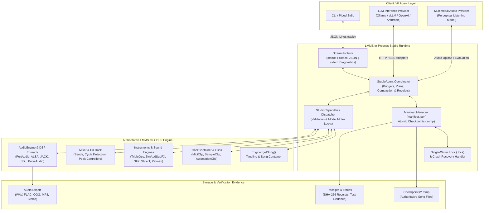

<div align="center">

# 🎵 HEAV3NS-MUSE

### **An Agent-Native Digital Audio Workstation, Built on LMMS**

*A persistent, conversational C++ music production runtime where autonomous AI agents inspect, compose, synthesize, mix, render, and evaluate music directly on native DAW DSP models.*

---

[](LICENSE.txt)
[](CMakeLists.txt)
[](CMakeLists.txt)
[](INSTALL.txt)
[](doc/agent-native-architecture.md)
[](doc/native-studio-protocol.md)

[Quickstart](#-quickstart-in-60-seconds) •
[Architecture](#-architecture--the-studio-loop) •
[Studio CLI](#-studio-cli-reference) •
[Wire Protocol](#-wire-protocol--ipc-reference) •
[Agent Reasoning](#-conversational-agent--reasoning) •
[Capabilities Matrix](#-studio-capabilities-matrix) •
[Hardware & Backends](#-audio--midi-hardware-backends) •
[Verification](#-testing--verification)

---

</div>

## 🌟 Overview

**HEAV3NS-MUSE** is an architectural evolution of [LMMS](https://github.com/LMMS/lmms), transforming the open-source digital audio workstation into a **persistent, conversational studio runtime**. 

Instead of generating disposable MIDI snippets or external audio stems, HEAV3NS-MUSE introduces an in-process agent runtime (`StudioRuntime`) directly within the LMMS C++ engine. AI reasoning models operate as collaborative producers: discovering available instruments, editing live arrangement timelines, sculpting synthesizer envelopes, routing mixer sends, rendering stems, and perceptually evaluating the results—while preserving complete native `.mmp` project compatibility and full graphical editability.

### Why Agent-Native DAW?

| Paradigm | Traditional DAW + AI Plugins | File-Generating Scripts (MIDI/WAV) | **HEAV3NS-MUSE (Agent-Native)** |
| :--- | :--- | :--- | :--- |
| **Execution Model** | Manual human DAW operation | One-shot code generation | **In-process conversational agent loop** |
| **State Authority** | GUI memory state | Ephemeral script output | **Authoritative native LMMS C++ DSP models** |
| **Project Editability** | Manual undo/redo | Statically baked files | **Native `.mmp` checkpoints with multi-turn undo** |
| **Sound Synthesis** | VST/Plugin black boxes | Fixed soundfonts or wavetables | **60+ native synths, samplers, SoundFonts & VSTs** |
| **Evaluation Loop** | Human ears only | Blind generation without feedback | **Render → Technical Analysis → Perceptual Listening** |
| **Headless Operation** | Not possible (requires GUI) | Command-line only | **Dual Mode: Headless (`QCoreApplication`) & GUI** |

---

## ⚡ Quickstart in 60 Seconds

### 1. Clone with Pinned Dependencies

```sh
git clone --recurse-submodules https://github.com/CardSorting/heav3ns-muse.git
cd heav3ns-muse
```

> [!TIP]
> If you already cloned without submodules, run `git submodule update --init --recursive` to pull bundled synthesis engines, SoundFont players, and Carla host libraries.

### 2. Configure & Build

Requires CMake 3.13+, a C++20 compiler (`gcc` 11+, `clang` 13+, or MSVC 2022), Qt 5.15+ (or Qt 6 via `-DWANT_QT6=ON`), and `libsndfile`.

```sh
# Configure out-of-tree build with testing enabled
cmake -S . -B build -DBUILD_TESTING=ON

# Compile in parallel across all CPU cores
cmake --build build --parallel
```

### 3. Launch an Agent Studio Session

Run a persistent, headless studio session reading and writing line-delimited JSON over standard I/O:

```sh
./build/lmms studio ./my-studio-session --config ~/.lmms-config.xml
```

### 4. Interactive "Hello World" Composition

Pipe line-delimited JSON directly to `./build/lmms studio ./my-studio-session` to initialize a project, load a synthesizer, write a 4-note melody, and render it to WAV:

```sh
cat << 'EOF' | ./build/lmms studio ./my-studio-session
{"id":"1","op":"project.new","args":{"empty":true}}
{"id":"2","op":"song.set","args":{"tempo":128,"masterVolume":100}}
{"id":"3","op":"track.add","args":{"type":"instrument","name":"Lead Synth"}}
{"id":"4","op":"instrument.load","args":{"track":0,"instrument":"tripleoscillator"}}
{"id":"5","op":"clip.add","args":{"track":0,"position":0}}
{"id":"6","op":"note.batch.add","args":{"track":0,"clip":0,"items":[{"position":0,"length":48,"key":60},{"position":48,"length":48,"key":64},{"position":96,"length":48,"key":67},{"position":144,"length":96,"key":72}]}}
{"id":"7","op":"project.save","args":{"path":"./my-studio-session/composition.mmp"}}
{"id":"8","op":"audio.render","args":{"path":"./my-studio-session/output.wav"}}
{"id":"9","op":"audio.analyze","args":{"path":"./my-studio-session/output.wav"}}
EOF
```

To open and inspect the resulting project in the full LMMS Graphical Interface at any time:

```sh
./build/lmms ./my-studio-session/composition.mmp
```

---

## 🏗️ Architecture & The Studio Loop

HEAV3NS-MUSE enforces the **Autonomous Music Production Lifecycle**:

```text
Interpret ➔ Plan ➔ Compose ➔ Synthesize ➔ Mix ➔ Render ➔ Listen ➔ Evaluate ➔ Revise ➔ Preserve
```

### Subsystem Flowchart



### Core Invariants

1. **Native DSP Authority**: No shadow models or parallel musical abstractions. Operations execute directly against live LMMS C++ engine objects (`Engine::getSong()`, `PatternStore`, `Mixer`, `AudioEngine`).
2. **Deterministic Durability**: Every project mutation creates an atomic `.mmp` snapshot with SHA-256 integrity verification, committed to an atomic `manifest.json`. Sessions withstand abrupt process termination (`kill -9`) without data loss.
3. **Headless Execution with Full Presentation Parity**: Studio mode initializes `QCoreApplication` without requiring an X11, Wayland, or Quartz display server. Projects remain 100% loadable and editable in the Qt GUI.
4. **Isolated Standard I/O Streams**: Standard output (`stdout`) is strictly reserved for machine-readable JSON protocol frames. Native C++ logging, DSP diagnostic messages, and crash warnings are redirected to `stderr`.
5. **Two-Stage Audio Understanding**: Technical audio metrics (peak dBFS, RMS power, clipping detection, silence ratios, spectral centroid) are calculated deterministically by C++ DSP routines (`audio.analyze`). Subjective aesthetic evaluation is delegated to an external audio multimodal reasoning model (`audio.listen`).

---

## 🖥️ Studio CLI Reference

Launch the studio using the `studio` subcommand:

```sh
lmms studio <session-directory> [options]
```

### Command-Line Arguments

| Flag | Argument | Description | Default |
| :--- | :--- | :--- | :--- |
| `<session-directory>` | Path | **Required.** Directory containing durable session checkpoints, manifests, transcripts, and receipts. Created if missing. | *None* |
| `--config` | File Path | Path to custom LMMS XML configuration file. Overrides system default configuration. | Standard system XML |
| `--studio-live` | *None* | Opens real audio and MIDI hardware backends. When omitted, the studio operates in offline mode with dummy drivers for fast headless rendering. | `false` (Dummy driver) |
| `--studio-audio` | Backend Name | Selects a compiled audio driver (`portaudio`, `alsa`, `jack`, `pulseaudio`, `sdl`, `sndio`, `dummy`, `auto`). Requires `--studio-live`. | `auto` |
| `--studio-midi` | Backend Name | Selects a compiled MIDI driver (`alsaseq`, `alsaraw`, `apple`, `winmm`, `jack`, `sndio`, `dummy`, `auto`). Requires `--studio-live`. | `auto` |

### Signal & Interruption Handling

- **`SIGINT` / `SIGTERM` (POSIX) or `CTRL_BREAK_EVENT` (Windows)**: Gracefully unwinds active C++ worker threads, pauses active inference jobs, commits current revision checkpoints to `manifest.json`, and emits an `event: "shutdown"` frame before exiting with status `0`.
- **Process Memory Limits**: Enforced via configured resident memory caps (`maximumResidentMiB`). Runaway memory allocations gracefully pause execution without corrupting session state.

---

## 📡 Wire Protocol & IPC Reference

HEAV3NS-MUSE communicates over `stdin` and `stdout` using newline-delimited JSON (JSON-Lines). Each line is an independent JSON object up to 1 MiB in size.

### Request Envelope

```json
{
  "id": "req-001",
  "op": "track.add",
  "args": {
    "type": "instrument",
    "name": "Sub Bass"
  },
  "expectedRevision": 4
}
```

- **`id`** *(string, required)*: Unique request identifier (1 to 128 characters). Used for correlation and replay deduplication.
- **`op`** *(string, required)*: The capability or session operation name.
- **`args`** *(object, required)*: Key-value parameters corresponding to the operation schema.
- **`expectedRevision`** *(integer, optional)*: Optimistic concurrency lock. Rejects the operation if the project revision has advanced.

### Response Envelope

```json
{
  "id": "req-001",
  "ok": true,
  "revision": 5,
  "result": {
    "track": 1,
    "name": "Sub Bass"
  }
}
```

If an operation fails, `ok` is `false`, and an explanatory `error` message is returned:

```json
{
  "id": "req-001",
  "ok": false,
  "revision": 4,
  "error": "Track index 8 is out of bounds (current project has 2 tracks)"
}
```

### Real-Time Runtime Events

The runtime pushes unsolicited notification frames during session lifecycle changes:

```json
{"event":"ready","session":"/path/to/session","revision":0,"applicationType":"QCoreApplication","transport":{"playing":false,"position":0}}
{"event":"agent","job":{"id":"job-8f2a","status":"running","operations":12,"elapsedMs":1450}}
{"event":"shutdown","ok":true,"reason":"process interrupt"}
```

### Idempotency & Replay Protection

Every mutating request is fingerprinted via SHA-256 and committed with its receipt into `<session-dir>/receipts/<uuid>.json`. Re-submitting an identical `id` returns the cached response with `"replayed": true`, preventing accidental duplicate note insertions or double-track additions during network retries.

---

## 🤖 Conversational Agent & Reasoning

HEAV3NS-MUSE includes native HTTP adapters for OpenAI-compatible and Anthropic inference APIs, allowing local models (via Ollama, vLLM, LM Studio) or frontier cloud models to act directly as music producers.

### 1. Configure the Reasoning Provider

Send `session.provider.set` to configure your language model:

```json
{
  "id": "set-llm",
  "op": "session.provider.set",
  "args": {
    "role": "reasoning",
    "configuration": {
      "protocol": "chat_completions",
      "endpoint": "http://127.0.0.1:11434/v1/chat/completions",
      "model": "qwen2.5-coder:32b",
      "keyEnv": "OLLAMA_API_KEY",
      "timeoutMs": 60000
    }
  }
}
```

> [!NOTE]
> For security, API keys are never stored in plain text within project manifests. The `keyEnv` field specifies the name of the environment variable containing the bearer token.

### 2. Configure the Perceptual Audio Provider

Configure an audio multimodal model to critique rendered compositions:

```json
{
  "id": "set-audio",
  "op": "session.provider.set",
  "args": {
    "role": "audio",
    "configuration": {
      "protocol": "chat_completions",
      "endpoint": "https://api.openai.com/v1/chat/completions",
      "model": "gpt-4o-audio-preview",
      "keyEnv": "OPENAI_API_KEY",
      "timeoutMs": 120000
    }
  }
}
```

### 3. Submitting Natural Language Production Prompts

Submit conversational intent either via `session.chat` or by sending raw natural-language text directly into `stdin`:

```json
{
  "id": "prompt-1",
  "op": "session.chat",
  "args": {
    "text": "Add a crisp, syncopated hi-hat pattern on sixteenth notes with velocity variation, then add a resonant low-pass filter to the lead synth.",
    "maxRounds": 8,
    "maxOperations": 50,
    "maximumWallTimeMs": 120000,
    "maximumCpuTimeMs": 30000,
    "maximumResidentMiB": 2048
  }
}
```

### 4. Agent Job Controls

- **`agent.inspect`**: Inspect active plan, tool invocation history, step progress, and resource utilization.
- **`agent.plan.set`**: Allows the agent to publish structured production plans (`goal`, `steps`, `decisions`).
- **`agent.context.compact`**: Compresses long conversation trajectories into structured summaries, avoiding token limits.
- **`agent.cancel`**: Immediately halts active inference or execution without corrupting song state.
- **`agent.resume`**: Resumes paused jobs with updated resource budgets.
- **`agent.finish`**: Closes a job with verifiable tool-call evidence (`evidence: ["call-id-1", "call-id-2"]`).

---

## 🎹 Studio Capabilities Matrix

HEAV3NS-MUSE exposes **over 60 high-level, typed C++ DAW operations** covering the complete LMMS feature set:

### 🎼 Project, Song & Timeline
| Operation | Key Parameters | Mutates | Description |
| :--- | :--- | :---: | :--- |
| `project.new` | `empty`, `summary` | Yes | Initialize a new song project. |
| `project.load` | `path`, `summary` | Yes | Load an existing `.mmp` or `.mmpz` project. |
| `project.save` | `path`, `withResources` | No | Serialize current state to native LMMS XML/compressed format. |
| `project.import` | `path`, `container`, `pattern` | Yes | Import external MIDI or project files into arrangement tracks. |
| `project.exportMidi` | `path` | No | Export editable tracks and notes as Standard MIDI File (`.mid`). |
| `project.inspect` | `section`, `track`, `clip`, `offset` | No | Deep inspection of tracks, clips, notes, routes, and warnings. |
| `song.set` | `tempo`, `masterVolume`, `masterPitch` | Yes | Set master tempo (BPM), master gain, and pitch transposition. |
| `timeline.set` | `begin`, `end`, `enabled` | Yes | Configure arrangement loop points and cycle mode. |

### 🎛️ Tracks & Clips
| Operation | Key Parameters | Mutates | Description |
| :--- | :--- | :---: | :--- |
| `track.add` | `type`, `name`, `container` | Yes | Create instrument, sample, pattern, or automation tracks. |
| `track.edit` | `track`, `name`, `muted`, `solo`, `to` | Yes | Rename, mute, solo, or reorder tracks in the arrangement. |
| `track.clone` | `track`, `container` | Yes | Duplicate a track, its instrument settings, and its effect chain. |
| `track.remove` | `track`, `container` | Yes | Safely remove an idle track and disarm active routing. |
| `clip.add` | `track`, `position`, `name` | Yes | Insert an empty arrangement clip at specified tick position. |
| `clip.edit` | `track`, `clip`, `position`, `length`, `offset` | Yes | Non-destructive clip timing, resizing, and trimming. |
| `clip.split` | `track`, `clip`, `position` | Yes | Split a clip into two independent clips at a tick offset. |
| `clip.clone` | `track`, `clip`, `position`, `targetTrack` | Yes | Copy clip data to a target track or pattern cell. |
| `clip.selection.copy`| `items: [{track, clip, position}]` | Yes | Batch copy up to 4,096 clips preserving linked groups. |

### 🎹 Piano Roll, Notes & Microtuning
| Operation | Key Parameters | Mutates | Description |
| :--- | :--- | :---: | :--- |
| `note.add` | `track`, `clip`, `position`, `length`, `key`, `volume` | Yes | Insert an explicitly timed MIDI note with velocity and panning. |
| `note.batch.add` | `track`, `clip`, `items: [...]` | Yes | High-speed batch insertion of up to 4,096 notes in one undo step. |
| `note.edit` | `track`, `clip`, `note`, `key`, `volume` | Yes | In-place modification of note pitch, length, or velocity. |
| `note.remove` | `track`, `clip`, `note` | Yes | Remove a single note from a MIDI clip. |
| `note.clear` | `track`, `clip` | Yes | Clear all notes in a clip while preserving clip geometry. |
| `note.selection.shift` | `notes: [...]`, `semitones`, `ticks` | Yes | Transpose pitch and/or shift timing of selected notes. |
| `note.selection.quantize` | `notes: [...]`, `grid`, `mode` | Yes | Quantize note starts and/or lengths to musical tick grids. |
| `note.selection.reverse` | `notes: [...]` | Yes | Invert note timing horizontally within selection bounds. |
| `note.selection.length` | `notes: [...]`, `mode`, `length` | Yes | Batch set, trim, or legato-fill note durations. |
| `note.selection.glue` | `notes: [...]` | Yes | Merge contiguous or overlapping notes of the same pitch. |
| `note.selection.split` | `notes: [...]`, `position` | Yes | Split crossing notes at a relative tick position. |
| `note.selection.knife` | `notes: [...]`, `fromPosition`, `fromKey`, `toPosition`, `toKey` | Yes | Cut notes along a continuous 2D coordinate line. |
| `note.detuning.point` | `note`, `position`, `value`, `progression`, `tension` | Yes | Add microtonal pitch bends / detuning points to individual notes. |

### 🥁 Beat & Bassline Sequencer
| Operation | Key Parameters | Mutates | Description |
| :--- | :--- | :---: | :--- |
| `step.set` | `track`, `clip`, `step`, `enabled` | Yes | Toggle a rhythm cell in the 16-step beat matrix. |
| `step.resize` | `track`, `clip`, `count` | Yes | Resize pattern row from 1 to 4,096 steps across full musical bars. |
| `step.clone` | `track`, `clip` | Yes | Double pattern length, duplicating existing step triggers. |

### 🎻 Sound Design, Synthesis & Slicing
| Operation | Key Parameters | Mutates | Description |
| :--- | :--- | :---: | :--- |
| `instrument.load` | `track`, `instrument`, `attributes` | Yes | Load TripleOscillator, ZynAddSubFX, BitInvader, Monstro, Patman, etc. |
| `instrument.inspect` | `track`, `offset`, `limit` | No | Enumerate synthesizer knobs, filter types, and modulation envelopes. |
| `sample.load` | `track`, `clip`, `path`, `preserveSettings` | Yes | Load audio files (WAV, FLAC, OGG, MP3) into sample tracks. |
| `sample.edit` | `track`, `clip`, `startFrame`, `endFrame`, `gain`, `reversed` | Yes | Non-destructive sample windowing, reverse playback, and gain. |
| `instrument.slices.analyze` | `track`, `estimateTempo` | Yes | Run native transient detection to auto-slice sample loops. |
| `instrument.slices.edit` | `track`, `points: [0.0, ..., 1.0]` | Yes | Set custom slice boundary points across a sample. |
| `clip.fromSlices` | `track`, `clip`, `targetTrack`, `position` | Yes | Generate piano roll trigger notes corresponding to sliced beats. |
| `preset.load` / `save` | `track`, `path` | Yes/No | Load or save native `.xpf` instrument presets. |
| `graph.set` / `load` | `track`, `graph`, `values`, `path` | Yes | Draw or decode custom single-cycle waveforms for oscillators. |
| `expression.set` | `track`, `expression`, `source` | Yes | Compile mathematical expressions for procedural waveform synthesis. |

### 🔌 External Plugins & Modular Patchbays
| Operation | Key Parameters | Mutates | Description |
| :--- | :--- | :---: | :--- |
| `plugin.list` | `subplugins` | No | Enumerate installed LADSPA, LV2, and VST plugins. |
| `host.plugin.add` | `track`, `format`, `path`, `uniqueId` | Yes | Host VST/LV2 plugins via native plugin hosts or Carla. |
| `host.parameter.set` | `track`, `hostedPlugin`, `hostedParameter`, `value` | Yes | Automate parameters inside third-party VST/LV2 plugins. |
| `host.catalog.start` | `track`, `format`, `binary`, `path` | No | Scan filesystem directories for new third-party plugins. |
| `host.patchbay.connect` | `track`, `sourceGroup`, `sourcePort`, `destGroup`, `destPort` | Yes | Modularly wire audio, MIDI, and CV routing in Carla Patchbay. |

### 📐 Microtonality & Scala Tunings
| Operation | Key Parameters | Mutates | Description |
| :--- | :--- | :---: | :--- |
| `tuning.scale.load` | `slot`, `path` | Yes | Load Scala (`.scl`) pitch tuning files. |
| `tuning.scale.set` | `slot`, `name`, `intervals` | Yes | Program arbitrary microtonal intervals and just intonations. |
| `tuning.keymap.load` | `slot`, `path` | Yes | Load Scala Keyboard Mapping (`.kbm`) definition files. |
| `instrument.tuning.inspect` | `track`, `key` | No | Inspect calculated frequencies (Hz) for every MIDI key. |

### 🎚️ Mixer, Routing & Effects
| Operation | Key Parameters | Mutates | Description |
| :--- | :--- | :---: | :--- |
| `mixer.add` | `name` | Yes | Add a discrete mixing channel strip to the mixer rack. |
| `mixer.edit` | `channel`, `name`, `volume`, `muted`, `solo`, `to` | Yes | Adjust fader volume, channel mute, solo, and rack position. |
| `mixer.route` | `from`, `to`, `amount` | Yes | Create send routes with cycle detection and send amount. |
| `mixer.unroute` | `from`, `to` | Yes | Disconnect send routing between two channels. |
| `effect.add` | `channel`, `plugin`, `attributes` | Yes | Add native delay, reverb, equalizer, compressor, or distortion. |
| `effect.move` | `channel`, `effect`, `direction`, `to` | Yes | Reorder insert effects within a channel's processing chain. |
| `effect.clear` | `channel` | Yes | Clear all effect inserts from a mixer channel. |

### 📈 Automation & Controllers
| Operation | Key Parameters | Mutates | Description |
| :--- | :--- | :---: | :--- |
| `automation.connect` | `track`, `clip`, `parameter` | Yes | Bind a track or mixer parameter to an automation curve. |
| `automation.point` | `track`, `clip`, `position`, `value`, `progression`, `tension` | Yes | Insert automation nodes (discrete, linear, or Hermite cubic). |
| `controller.add` | `type`, `name` | Yes | Add LFO, Peak Controller, or MIDI controller to the rack. |
| `controller.connect` | `controller`, `parameter` | Yes | Link modulation controllers directly to any synthesiser parameter. |
| `controller.midi.learn` | `parameter`, `port`, `timeoutMs` | Yes | Listen for external hardware MIDI CC knobs and bind them automatically. |

### 🎧 Audio Rendering & DSP Analysis
| Operation | Key Parameters | Mutates | Description |
| :--- | :--- | :---: | :--- |
| `audio.render` | `path`, `sampleRate`, `bitDepth`, `stereoMode`, `exportLoop` | No | Render entire song mix or isolated stems to WAV, FLAC, OGG, or MP3. |
| `audio.analyze` | `path`, `maximumSeconds` | No | Measure peak amplitude, RMS power, clipping count, and silence. |
| `audio.listen` | `path`, `prompt` | No | Submit rendered audio to multimodal audio provider for critique. |

---

## 🔊 Audio & MIDI Hardware Backends

HEAV3NS-MUSE supports full real-time hardware operation as well as headless virtual studio runs.

### Supported Drivers

| System Driver | Audio Device Kind | MIDI Driver Kind | Linux | macOS | Windows |
| :--- | :--- | :--- | :---: | :---: | :---: |
| **PortAudio** | DirectSound, WASAPI, CoreAudio, ALSA | N/A | ✅ | ✅ | ✅ |
| **ALSA** | Advanced Linux Sound Architecture | `alsaseq` / `alsaraw` | ✅ | ❌ | ❌ |
| **JACK** | Low-latency audio server | JACK MIDI client | ✅ | ✅ | ❌ |
| **PulseAudio** | Desktop audio daemon | N/A | ✅ | ❌ | ❌ |
| **SDL** | Simple DirectMedia Layer | N/A | ✅ | ✅ | ✅ |
| **Apple MIDI** | N/A | CoreMIDI client | ❌ | ✅ | ❌ |
| **WinMM** | N/A | Windows Multimedia MIDI | ❌ | ❌ | ✅ |
| **sndio** | OpenBSD audio framework | sndio MIDI | ✅ | ❌ | ❌ |
| **Dummy** | In-memory clock (no audio hardware needed) | Null MIDI | ✅ | ✅ | ✅ |

### Live Driver Inspection & Switching

Discover and switch drivers at runtime without restarting the process:

```json
{"id":"list-backends","op":"audio.backend.list","args":{}}
{"id":"switch-audio","op":"audio.backend.select","args":{"name":"jack"}}
{"id":"switch-midi","op":"midi.backend.select","args":{"name":"alsaseq"}}
```

---

## 🛡️ Reliability, Persistence & Directory Anatomy

Every studio session directory is a self-contained, fully auditable package.

### Directory Structure

```text
my-studio-session/
├── .lock                     # Single-writer mutual exclusion file lock
├── manifest.json             # Atomic master session manifest & revision pointer
├── checkpoints/              # Immutable LMMS song snapshots
│   ├── a8b3f120-....mmp      # Snapshot for revision 1
│   └── 3c91d4e0-....mmp      # Snapshot for revision 2
├── receipts/                 # SHA-256 idempotency receipts for client calls
│   ├── e4f1092a-....json     # Execution outcome & response for request ID
│   └── 90bcf312-....json
├── memory/                   # Retained cross-session musical preferences & state
└── archives/                 # Compacted agent conversation context histories
```

### Crash Recovery Guarantees

- **Single-Writer Protection**: Multiple processes cannot concurrently open the same session directory.
- **Atomic Two-Phase Commits**: Checkpoints are written to temporary files and verified before renaming. The commit point is a single atomic update to `manifest.json`.
- **Automatic Garbage Collection**: Uncommitted temporary files or abandoned render runs are safely scrubbed upon session restart.

---

## 🧪 Testing & Verification

HEAV3NS-MUSE includes a rigorous test suite combining unit tests and end-to-end process-level integration harnesses.

### 1. Native CTest Suite

```sh
ctest --test-dir build --output-on-failure
```

### 2. Comprehensive Process-Level Integration Harness

Exercises headless studio startup, JSON protocol boundaries, audio synthesis correctness, signal interruption (`SIGINT`/`SIGTERM`), memory budgets, and mock inference loops:

```sh
python tests/studio_process_test.py --lmms ./build/lmms --output ./build/studio-evidence
```

### 3. VST & External Host Stress Harness

Tests external plugin discovery, parameter modulation, and Carla patchbay connections without a display server:

```sh
python tests/studio_vst_process_test.py --lmms ./build/lmms --output ./build/vst-evidence
```

---

## 🗺️ Implementation Status & Roadmap

HEAV3NS-MUSE is an active development fork. The table below outlines completion progress across core development gates:

| Subsystem / Gate | Implementation Status | Verification Evidence |
| :--- | :---: | :--- |
| **Headless Studio Lifecycle** | ✅ Complete | Verified in `tests/studio_process_test.py` across Linux/macOS/Windows |
| **Line-Delimited JSON Protocol** | ✅ Complete | Stream isolation, 1 MiB framing, error propagation verified |
| **Authoritative LMMS C++ Mutators** | ✅ Complete | Over 60 operations implemented in `StudioCapabilities.cpp` |
| **Piano Roll & Microtuning** | ✅ Complete | Batch note insertion, quantization, Scala `.scl`/`.kbm` support |
| **Synthesizer & Sampler Engines** | ✅ Complete | TripleOscillator, AudioFileProcessor, SlicerT, Patman, SF2Player |
| **Session Persistence & Recovery** | ✅ Complete | Atomic manifests, SHA-256 receipts, single-writer lock |
| **Inference Provider Adapters** | ✅ Complete | OpenAI Chat Completions & Anthropic protocols implemented |
| **Two-Stage Audio Understanding** | 🟡 In Progress | DSP analysis complete; live multimodal evaluation in testing |
| **Live Audio/MIDI Hardware** | 🟡 In Progress | Hot-swapping backends implemented; hardware edge cases ongoing |
| **Extended VST3 / CLAP Hosting** | 🔵 Planned | Carla VST2/LV2 supported; native VST3/CLAP roadmap planned |

For detailed engineering logs, architectural decisions, and open gates, see [Engineering Record](doc/agent-native-architecture.md) and [Native Studio Protocol](doc/native-studio-protocol.md).

---

## 🤝 Contributing

We welcome contributions from audio software engineers, AI researchers, and digital musicians!

1. **Fork & Branch**: Create a feature branch (`git checkout -b feature/audio-capability`).
2. **Coding Standards**: C++20 standard, adhering to `.clang-format` and `.clang-tidy`.
3. **Preserve Native Authority**: All capabilities must execute against native LMMS C++ models—no shadow state or external mock models.
4. **Testing Required**: Any new operation added to `StudioCapabilities.cpp` must include corresponding test coverage in `tests/studio_process_test.py`.
5. **Issue Tracking**: Submit issues and pull requests via [CardSorting/heav3ns-muse](https://github.com/CardSorting/heav3ns-muse).

---

## 📜 Lineage & License

HEAV3NS-MUSE is proudly built upon the foundation of [LMMS](https://github.com/LMMS/lmms) and the decades of work by the LMMS Development Community. Development of the agent-native runtime began from upstream commit `a2f57e70c`.

This project is licensed under the **GNU General Public License v2.0 or later** ([GPL-2.0-or-later](LICENSE.txt)). Bundled plugins, soundfonts, waveforms, and third-party libraries retain their respective licenses and copyright notices.

---

<div align="center">
<sub>Built with 🎵 by the HEAV3NS-MUSE contributors and the open-source audio community.</sub>
</div>
