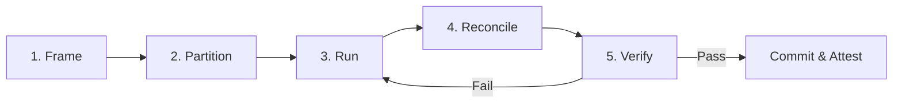

# AI Agent Pair Programming & Governance

<!-- docs-scope: current-guide -->

Guidelines for AI agents and human engineers collaborating on the HEAV3NS-MUSE codebase. The core architectural invariant is that **native C++ LMMS models (`Engine::getSong()`, `Mixer`, `PatternStore`, `AudioEngine`) are the sole and final authority**. Agents must never invent shadow project representations or fabricate unverified audio capabilities.

---

## 1. Parent & Subagent Orchestration

When a task requires multi-agent delegation or subagent fan-out, the parent agent retains full accountability for architectural integrity, verification, and final integration.

### High-Throughput Operating Loop

Agents operating within this repository follow a structured 5-stage loop:



1. **Frame**: State the concrete outcome, public/private boundary, files in scope, and verification command before beginning.
2. **Partition**: Split work across independent evidence lanes—e.g., DSP implementation, test harness design, documentation synchronization—not by arbitrary line counts.
3. **Run**: Execute bounded reads, compilations, and tests with explicit timeouts. Every lane has one owner, one output contract, and one blocker category.
4. **Reconcile**: The parent agent merges changes, eliminates duplicate side-effects, and confirms that every accepted result is backed by physical evidence. An uncertain subagent result is never treated as success.
5. **Verify**: Run the smallest relevant checks first (`scripts/verify-docs.py`), followed by compilation (`cmake --build build`), test suites (`npm run test:studio`), and documentation checks (`npm run docs:check`).

### Subagent Work Ledger

Parent agents must maintain an internal or documented work ledger with strictly defined states:

| State | Definition | Action Required |
| :--- | :--- | :--- |
| `queued` | Task framed but not yet dispatched | Await execution lane capacity |
| `running` | Subagent actively executing bounded task | Monitor execution against deadline |
| `accepted` | Subagent delivered complete evidence meeting acceptance criteria | Merge into integration tree |
| `uncertain` | Subagent execution timed out, crashed, or returned ambiguous state | Retain original state; do NOT redispatch blindly |
| `blocked` | Execution blocked by an external missing dependency or permission | Document specific unblocker |
| `cancelled` | Task obsoleted by parent decision | Clean up scratch artifacts |

---

## 2. Child Handoff Packet Contract

Every subagent or task lane must return a structured handoff packet upon completion:

```json
{
  "taskId": "task-studio-step-sequencer",
  "outcome": "completed",
  "state": "accepted",
  "filesInspected": [
    "include/Song.h",
    "src/core/Song.cpp"
  ],
  "filesModified": [
    "src/core/studio_process.cpp",
    "tests/studio_process_test.py"
  ],
  "evidence": {
    "testCommand": "python3 tests/studio_process_test.py --lmms build/lmms",
    "testOutput": "Pass: 12 tests, 0 failures",
    "exitCode": 0
  },
  "nextSafeAction": "Run npm run docs:check and record maintainer domain review",
  "blocker": null
}
```

---

## 3. Anti-Hallucination & Model Authority Invariants

1. **Zero Shadow ASTs**: LMMS C++ engine objects (`Song`, `TrackContainer`, `InstrumentTrack`, `Mixer`) hold the project state. Never construct a parallel Python-side or JSON-side project model that can drift from the C++ core.
2. **Deterministic Synchronous Mutation**: All DAW edits executed via JSON-RPC over the studio socket (`studio_process`) must execute synchronously on the main thread via Qt event dispatch or return explicit error codes (`INVALID_TRACK`, `CLIP_OUT_OF_BOUNDS`).
3. **Idempotent Identifiers**: Operations mutating state must accept or return stable IDs (`track_id`, `clip_id`, `step_index`) rather than volatile transient pointers.
4. **Physical Verification Precedes Completion**: An agent must never mark a roadmap gate or feature "completed" without executing the verifying script and recording the physical command output.

---

## 4. Documentation & Attestation Rules

When code in `src/core/` or `plugins/` changes:
1. Identify affected domains using `python3 scripts/docs-kb.py impact`.
2. Update corresponding documentation guides and capability tables.
3. Run `npm run docs:check` to ensure zero broken links, valid `docs-scope` tags, and intact ADR indexing.
4. Run `npm run docs:review` with explicit notes to update the cryptographic SHA-256 source fingerprints in `doc/knowledge/reviews.json`.
