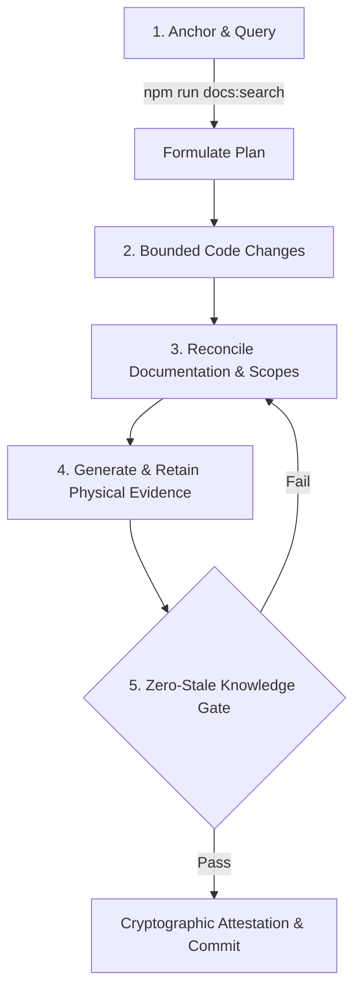

# Contracted Agent Anchor Protocol & High-Velocity Data Pipeline

<!-- docs-scope: current-guide -->

Operational contract governing autonomous agents and contracted engineers working on HEAV3NS-MUSE. In high-velocity development environments, **documentation is the immutable anchor of truth**: codebase changes must never outpace or contradict active documentation, and historical verification artifacts must never be deleted.

---

## 1. The Core Anchoring Doctrine

Every autonomous agent contracted to perform work in this repository operates under four immutable anchoring rules:



1. **Rule 1: Query Before Mutation (`npm run docs:search`)**:
   Before modifying any file in `src/core/`, `plugins/`, or `include/`, agents must search active guides and ADRs to determine authoritative state models, threading constraints, and existing capabilities.
2. **Rule 2: Whole-Document Reconciliation**:
   Code changes and documentation changes must be committed together. Never leave contradictory recipes or outdated parameter schemas behind. Obsolete recipes must be removed from active guides.
3. **Rule 3: Physical Evidence Permanence**:
   Completing a feature or closing a roadmap gate requires executing physical test commands and archiving the execution receipt under `doc/evidence/test-runs/`. Prior test runs and benchmarks are permanent records; they must never be deleted.
4. **Rule 4: Zero Stale Knowledge Gate**:
   The CI pipeline enforces cryptographic verification (`npm run docs:check`). A pull request with unreviewed domains, modified sources lacking review attestations, or broken links fails immediately.

---

## 2. Agent Execution Workflow

### Step 0: Pre-Flight Ground Truth Anchor Verification
Before initiating any task, contracted agents must verify that the environment and repository are grounded in authoritative invariants:
```sh
# Verify active horizon, core source mappings, and zero-stale domain seals
npm run docs:anchor

# Or dump the compiled machine-readable anchor context directly into system prompts:
npm run docs:anchor:dump
```
If `npm run docs:anchor` fails, stop immediately: the workspace is ungrounded or source code has drifted ahead of documentation.

### Step 1: Discover Authoritative Guidance
Use the offline knowledge search engine:
```sh
# Search active guides for specific capabilities or architecture rules
python3 scripts/docs-kb.py search "track model authority"
python3 scripts/docs-kb.py search "audio thread lock-free"
python3 scripts/docs-kb.py search "capture pipeline transaction"
```

### Step 2: Analyze Source Impact
Before editing, identify which of the 7 knowledge domains govern the target files:
```sh
npm run docs:impact
```

### Step 3: Implement & Validate Invariants
Execute the bounded changes. Ensure compliance with:
- **Zero Allocation in Real-Time Loop**: No `malloc`, `new`, or mutex locks in the audio rendering path.
- **Model Authority**: State lives in native C++ `Song` and `Mixer`; no shadow state in Python or JSON.

### Step 4: Record Physical Evidence
Generate a dated test receipt:
```sh
python3 scripts/docs-kb.py record-evidence \
  --gate GATE-014 \
  --command "python3 tests/studio_process_test.py" \
  --artifact doc/evidence/test-runs/20261015-perception-test.json \
  --note "Verified two-stage audio perception pipeline"
```

### Step 5: Seal Knowledgebase Domains
Run maintainer review attestation to update cryptographic SHA-256 source fingerprints:
```sh
npm run docs:review -- --domain <id> --reviewer "Agent: <Model-Name>" --note "<Review Context>"
```

### Step 6: Verify the Zero-Stale Gate
```sh
npm run docs:check
npm run docs:status -- --fail-on-due --fail-on-unreviewed
```
Both commands must exit with code 0.
