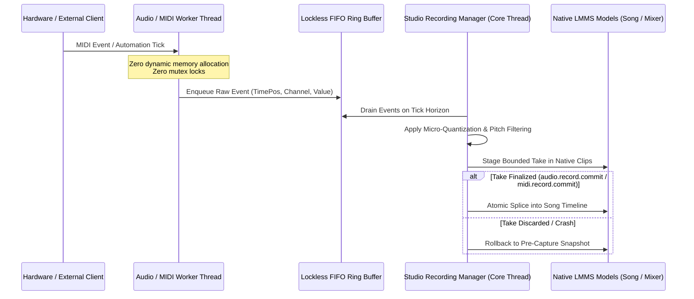

# Live Recording, MIDI Ingestion & Automation Capture Pipeline

<!-- docs-scope: current-guide -->

Technical reference and operational architecture for the real-time capture data pipeline in HEAV3NS-MUSE. This document details how bounded MIDI note recording, automation parameter capture, and sample stream ingestion interface with in-process LMMS C++ models while maintaining lockless real-time audio thread safety.

---

## 1. Architectural Overview & Dataflow

The live capture engine bridges asynchronous input events (MIDI hardware, virtual controllers, dynamic parameter tweaks) with the deterministic timeline of `Song` and `PatternStore`.



---

## 2. Core Subsystem Responsibilities

The capture pipeline is divided into dedicated C++ components in `src/core/`:

| Component | Header | Implementation | Subsystem Responsibility |
| :--- | :--- | :--- | :--- |
| **`StudioRecording`** | [StudioRecording.h](file:///Users/bozoegg/Downloads/heav3ns-muse-main/include/StudioRecording.h) | [StudioRecording.cpp](file:///Users/bozoegg/Downloads/heav3ns-muse-main/src/core/StudioRecording.cpp) | Top-level capture coordinator, take lifecycle management, session armed state, transport interlocking. |
| **`StudioMidiRecording`** | [StudioMidiRecording.h](file:///Users/bozoegg/Downloads/heav3ns-muse-main/include/StudioMidiRecording.h) | [StudioMidiRecording.cpp](file:///Users/bozoegg/Downloads/heav3ns-muse-main/src/core/StudioMidiRecording.cpp) | Frame-accurate note-on/note-off capture, velocity normalization, pitch-bend routing (`recordPitch`). |
| **`StudioMidiLearn`** | [StudioMidiLearn.h](file:///Users/bozoegg/Downloads/heav3ns-muse-main/include/StudioMidiLearn.h) | [StudioMidiLearn.cpp](file:///Users/bozoegg/Downloads/heav3ns-muse-main/src/core/StudioMidiLearn.cpp) | Dynamic CC mapping, controller link binding, parameter takeover smoothing. |
| **`StudioAutomationRecording`** | [StudioAutomationRecording.h](file:///Users/bozoegg/Downloads/heav3ns-muse-main/include/StudioAutomationRecording.h) | [StudioAutomationRecording.cpp](file:///Users/bozoegg/Downloads/heav3ns-muse-main/src/core/StudioAutomationRecording.cpp) | Automation curve interpolation, breakpoint decimation, node journal recording. |

---

## 3. Native DAW Mutation & Transaction Pipeline

Direct timeline edits during or after capture use deterministic native mutation operations in `src/core/`:

- **Clip Management**:
  - `NativeClipEdit.cpp`: Handles clip splits, edge resizing, and boundary clamping without altering unaffected timeline regions.
  - `NativeClipTransfer.cpp`: Inter-track clip transfers with automated track-type compatibility checks.
- **Note Processing & Quantization**:
  - `NativeNoteTransfer.cpp`: Bulk note migration between patterns and clips.
  - `NativeNoteShift.cpp`: Pitch transposition and temporal shifting with boundary preservation.
  - `NativeNoteGlue.cpp`: Merges contiguous overlapping takes into single legato note blocks.
- **Parameter & Model Journaling**:
  - `NativeControlLinkJournal.cpp`: Records atomic parameter automation linkages, allowing deterministic undo/rollback.
  - `NativeLinkedControls.cpp`: Multi-parameter macro dispatch and cross-track linking.
  - `NativeTrackSaveSnapshot.cpp`: Snapshots track state prior to capture armed mode; restored instantly if a capture take aborts.
  - `NativeValueNotification.cpp`: Emits bounded telemetry on parameter changes to external JSON-RPC clients.

---

## 4. Operational Invariants for Autonomous Agents

Contracted agents interacting with the capture pipeline must obey the following architectural rules:

1. **Transport Interlock**:
   - `audio.record` and `midi.record` require the transport to be stopped when arming.
   - You cannot arm recording while an offline render (`render.export_wav` or `render.stems`) is running.
2. **Explicit Bounded Transactions**:
   - Every live recording take must begin with an arming call and complete with an explicit `commit` or `discard`.
   - Dangling uncommitted takes are automatically reclaimed if a disconnect occurs.
3. **Lockless Real-Time Boundary**:
   - Never introduce mutex locks or memory allocations (`malloc`, `new`, `std::vector::push_back` without reserve) inside callback functions invoked from the audio clock.
   - Use preallocated ring buffers (`RingBuffer.cpp`) for all cross-thread telemetry.
4. **State Authority**:
   - The authoritative representation of recorded notes is `PatternClip::notes()`, not client-side state buffers.

---

## 5. Verification Commands & Diagnostics

To verify capture pipeline integrity and execute end-to-end regression tests:

```sh
# Run headless studio capture & process tests
python3 tests/studio_process_test.py

# Verify documentation and cryptographic review freshness for live-capture
python3 scripts/docs-kb.py check

# Record physical evidence receipt after running capture tests
python3 scripts/docs-kb.py record-evidence \
  --gate GATE-014 \
  --command "python3 tests/studio_process_test.py" \
  --artifact doc/evidence/test-runs/receipt.json \
  --note "Verified live capture and MIDI recording transaction pipeline"
```
