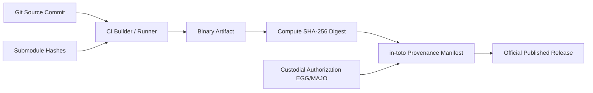

# Release Provenance, Artifact Integrity & Archival Standards

<!-- docs-scope: current-guide -->

Specification for generating verifiable SLSA-aligned release provenance metadata, artifact checksums, dependency pin records, and custodial publication authorization pursuant to **HEAV3NS Engineering Commission 011 Gate 5**.

---

## 1. Institutional Boundaries & Authority

HEAV3NS-MUSE is an open-source computational artifact built upon LMMS and licensed under GPL-2.0-or-later.

- **A successful CI build does NOT authorize public release.**
- Founding Custodian (**EGG**) and Executive Chair (**MAJO**) retain exclusive custodial publication authority.
- Autonomous contracted agents and maintainers may prepare release candidates and provenance manifests, but public publishing remains gated on explicit custodial approval.

---

## 2. SLSA v1 in-toto Provenance Architecture

Every official release artifact (e.g. AppImage, DMG, Windows binary, source tarball) must be accompanied by an immutable SLSA v1 in-toto statement:



### Required Provenance Fields
1. **`subject`**: Array of released binary artifacts with filenames, byte sizes, and cryptographic SHA-256 digests.
2. **`predicate.buildDefinition`**:
   - Exact source repository (`https://github.com/CardSorting/heav3ns-muse`).
   - Full 40-character commit SHA and git tag.
   - Host platform, compiler toolchain, and builder identity.
3. **`predicate.runDetails`**:
   - Submodule commit pinning manifest across all 17 submodules.
   - Number of physical evidence receipts verified in `doc/evidence/registry.json`.
   - Custodial publication authorization stamp (`authorized_by`, `authority_role`, `authorization_timestamp`).

---

## 3. Provenance Generation Procedure

To generate a release provenance manifest for release candidate artifacts:

```sh
# Generate provenance manifest for compiled binaries
python3 scripts/generate-provenance.py \
  --version 1.0.0-rc1 \
  --artifacts build/lmms-*.AppImage build/lmms-*.dmg \
  --output doc/evidence/release-provenance.json
```

When custodial authorization has been granted by Founding Custodian EGG:
```sh
python3 scripts/generate-provenance.py \
  --version 1.0.0-rc1 \
  --artifacts build/lmms-*.AppImage build/lmms-*.dmg \
  --output doc/evidence/release-provenance.json \
  --authorized-by "EGG"
```

---

## 4. Archival & Traceability

1. **Evidence Registry Retention**:
   All CI test receipts and build evidence are permanently retained in `doc/evidence/registry.json` and `doc/evidence/ci-runs/`. Prior milestone receipts must never be deleted or modified.
2. **Checksum Verification**:
   Users and downstream packaging systems can verify release integrity using standard SHA-256 utilities:
   ```sh
   sha256sum -c release-checksums.sha256
   ```
3. **Limitation Disclosures**:
   Every release notes document must link to [Auto-Rolling Roadmap](../../ROADMAP.md) and [Active Open Items](../roadmap/OPEN_ITEMS.md) disclosing any experimental or platform-limited features.
